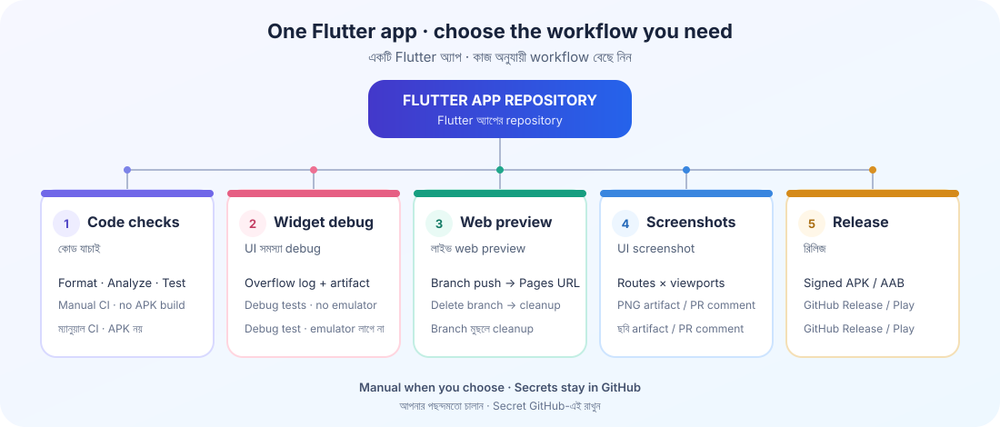

# Flutter Builder

**Reusable GitHub Actions for Flutter apps**<br>
**Flutter app-এর জন্য reusable GitHub Actions**

Install once, run the workflow you need. / একবার setup করুন, প্রয়োজনের workflow চালান।

<p align="center">
  
</p>

## At a glance / এক নজরে

| Goal / কাজ | Workflow | What you get / কী পাবেন |
|---|---|---|
| **Check code / কোড যাচাই** | [`ci.yml`](examples/project-workflows/ci.yml) → [`flutter-build.yml`](.github/workflows/flutter-build.yml) | Manual format, analyze and tests; no APK build. / ম্যানুয়ালি format, analyze ও test; APK build নয়। |
| **Debug layout / UI overflow debug** | [`widget-tests.yml`](examples/project-workflows/widget-tests.yml) → [`flutter-widget-tests.yml`](.github/workflows/flutter-widget-tests.yml) | Debug-mode tests, error summary and full log artifact. The test must render the affected screen. / Debug test, error summary ও পুরো log artifact; test-এ সমস্যার screen তুলতে হবে। |
| **Live web preview / লাইভ web preview** | [`web-preview.yml`](.github/workflows/web-preview.yml) + [`preview-cleanup.yml`](.github/workflows/preview-cleanup.yml) | Relevant branch push publishes a preview; deleting the branch cleans it up. / Relevant branch push-এ preview, branch delete হলে cleanup। |
| **Review screens / UI screenshot** | [`ui-screenshots.yml`](.github/workflows/ui-screenshots.yml) | Browser screenshots for chosen routes and sizes; artifact, plus a PR comment for eligible same-repo PR runs. / নির্দিষ্ট route ও size-এর screenshot; artifact এবং উপযুক্ত same-repo PR-এ comment। |
| **Build or release / Build বা release** | [`manual-build.yml`](examples/project-workflows/manual-build.yml) + [`publish-release.yml`](.github/workflows/publish-release.yml) | APK/AAB artifacts; signed release and optional Play upload. / APK/AAB artifact; signed release ও ঐচ্ছিক Play upload। |

The installer adds the standard callers. CI, screenshots and releases are manual by default; web preview runs on relevant pushes.<br>
Installer সাধারণ caller ফাইল বসায়। CI, screenshot ও release সাধারণত manual; web preview নির্দিষ্ট push-এ চলে।

## Quick start / দ্রুত শুরু

Run from the Flutter app repository root. / Flutter app repository-র root থেকে চালান:

```bash
curl -fsSL https://raw.githubusercontent.com/Keshab1997/flutter-builder/v1.15.0/scripts/install.sh | bash
```

It installs four caller workflows. It does **not** install Flutter, create secrets, commit/push, or start a run. For a monorepo, add `--app-dir apps/mobile`; use `--dry-run` to preview changes and `--force` to replace a custom file (a backup is made).<br>
এটি চারটি caller workflow বসায়। Flutter SDK install, secret তৈরি, commit/push বা workflow run করে না। Monorepo-তে `--app-dir apps/mobile`; আগে দেখতে `--dry-run`, custom file backup নিয়ে বদলাতে `--force` দিন।

Reusable workflows should be pinned to a release tag. After a new release, update existing callers with:

```bash
curl -fsSL https://raw.githubusercontent.com/Keshab1997/flutter-builder/v1.15.0/scripts/bump-ref.sh | bash
```

Reusable workflow production-এ release tag-এ pin করুন। নতুন release এলে `bump-ref.sh` দিয়ে পুরোনো caller-গুলোর pin update করুন।

## Fast widget-test diagnostics / দ্রুত Widget-test debug

The focused runner uses `flutter test` in debug mode—no Android emulator. It captures `RenderFlex overflowed` and similar errors in the run summary and uploads the full console log as `flutter-widget-test-log`.<br>
এই runner debug mode-এ `flutter test` চালায়—Android emulator লাগে না। `RenderFlex overflowed`-এর মতো error run summary-তে দেখায় এবং পুরো console log `flutter-widget-test-log` artifact হিসেবে রাখে।

Copy the caller example into the app's `.github/workflows/` directory, then run **Actions → Flutter widget-test diagnostics → Run workflow**. It pins the runner at `v1.15.0`:

- [Reusable runner](.github/workflows/flutter-widget-tests.yml)
- [Manual caller example](examples/project-workflows/widget-tests.yml)

Manual caller example-টি app-এর `.github/workflows/`-এ কপি করে **Actions → Flutter widget-test diagnostics → Run workflow** চালান। এটি `v1.15.0` release-এ থাকা runner-কে pin করে।

**Important / জরুরি:** The workflow only tests screens that your tests build; it does not launch or navigate the app. For a mobile overflow, render the affected screen at a phone-sized viewport, for example:

Workflow শুধু test-এ render করা screen-গুলোই পরীক্ষা করে; নিজে app চালিয়ে ঘোরে না। Mobile overflow ধরতে সংশ্লিষ্ট screen-টি phone-sized viewport-এ render করুন, যেমন:

```dart
testWidgets('home fits a phone viewport', (tester) async {
  tester.view.physicalSize = const Size(360, 800);
  tester.view.devicePixelRatio = 1;
  addTearDown(tester.view.resetPhysicalSize);
  addTearDown(tester.view.resetDevicePixelRatio);

  await tester.pumpWidget(const MyApp()); // replace with your app/screen
  await tester.pumpAndSettle();
});
```

Replace `MyApp` with the app root or the affected screen, and add any required mocks. The reusable runner ships in `v1.15.0`; the caller uses that release tag.<br>
`MyApp`-এর জায়গায় app root বা সমস্যার screen দিন; দরকার হলে mock যোগ করুন। Reusable runner `v1.15.0` release-এ আছে; caller ওই tag-ই ব্যবহার করে।

## Web preview & screenshots / Web preview ও screenshot

- **Preview:** app needs a `web/` folder; enable GitHub Pages once with `gh-pages` as the source. The branch URL is shown in the Actions summary and preview hub. Simple short branch names keep their old paths; lossy, long, or hash-looking names get a SHA-256 suffix. Branch deploy and delete cleanup use the same rule.<br>
  **Preview:** app-এ `web/` folder থাকা চাই; GitHub Pages-এ একবার `gh-pages` source নির্বাচন করুন। Branch URL Actions summary ও preview hub-এ দেখা যায়। ছোট safe branch name-এর পুরোনো path থাকে; lossy/লম্বা/hash-এর মতো নাম SHA-256 suffix পায়। Deploy ও delete cleanup একই নিয়ম মানে। প্রথম hashed deploy-এর পর পুরোনো sanitized folder থেকে যেতে পারে—একবার manually সরান।
- **Screenshots:** web build only—not an Android emulator. The reusable workflow can post/update a comment on eligible same-repo PR runs; the supplied caller is manual. Platform-only plugins may not render.<br>
  **Screenshot:** শুধু web build—Android emulator নয়। উপযুক্ত same-repo PR run-এ reusable workflow comment দিতে/update করতে পারে; দেওয়া caller manual। Web-এ চলে না এমন plugin render নাও হতে পারে।

Measure recent preview times (read-only):

```bash
python3 scripts/preview_timing.py --repo OWNER/REPO --limit 20
```

সাম্প্রতিক preview-এর সময় মাপতে (শুধু read-only)। Private repo-তে `gh auth login`, `GITHUB_TOKEN`/`GH_TOKEN` বা `--token-file PATH` ব্যবহার করুন; token output হয় না।

## Releases & security / Release ও নিরাপত্তা

Signed builds and Play uploads need repository secrets. Keep keystores, tokens and private keys out of git; see [secret setup](docs/AGENT_SECRETS_SETUP.md). A release workflow can publish a tag/release, so run it deliberately.<br>
Signed build ও Play upload-এর জন্য repository secret লাগে। Keystore, token বা private key git-এ রাখবেন না; [secret setup](docs/AGENT_SECRETS_SETUP.md) দেখুন। Release workflow tag/release প্রকাশ করতে পারে—সতর্কভাবে চালান।

About → Website automation needs `APP_PRIVATE_KEY` (GitHub App) or `ABOUT_LINK_TOKEN`; `about-link-overwrite` controls replacing an existing link. / About → Website automation-এ `APP_PRIVATE_KEY` (GitHub App) অথবা `ABOUT_LINK_TOKEN` লাগে; বিদ্যমান link বদলাবে কি না `about-link-overwrite` ঠিক করে।

## Agent tools / Agent-এর tools

Optional, no Flutter SDK required. / ঐচ্ছিক; Flutter SDK লাগে না।

```bash
curl -fsSL https://raw.githubusercontent.com/Keshab1997/flutter-builder/v1.15.0/scripts/install-agent-pack.sh | bash
```

| Tool | Purpose / কাজ |
|---|---|
| `tool/preflight.py` | Catch common Dart issues before pushing. / Push-এর আগে সাধারণ Dart সমস্যা ধরে। |
| `tool/ci_watch.py` | Read Actions results and failing logs. / Actions result ও fail log পড়ে। |
| `tool/agent_loop.py` | Preflight, secret guard, commit and push in one loop. / এক loop-এ preflight, secret guard, commit ও push। |
| `scripts/doctor.sh` | Check app/release configuration. / App ও release configuration যাচাই করে। |

More details / আরও তথ্য: [workflow examples](examples/project-workflows/), [secrets guide](docs/AGENT_SECRETS_SETUP.md), [preview timing script](scripts/preview_timing.py).<br>
License: [MIT](LICENSE).
