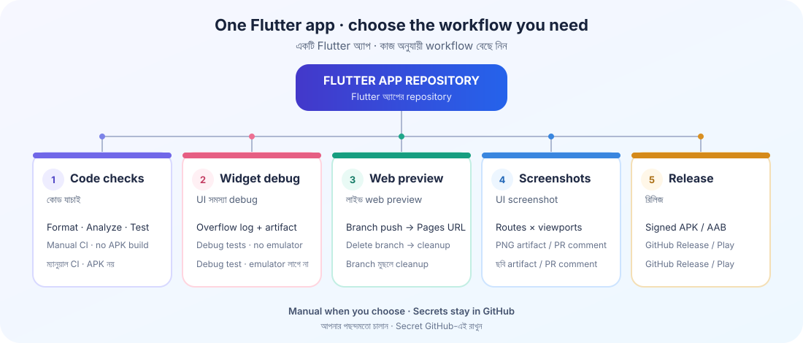

# Flutter Builder

**Reusable GitHub Actions for Flutter apps**<br>
**Flutter app-এর জন্য reusable GitHub Actions**

Install once, run the workflow you need. / একবার setup করুন, প্রয়োজনের workflow চালান।

<p align="center">
  
</p>

## At a glance / এক নজরে

| Goal / কাজ | Workflow | What you get / কী পাবেন |
|---|---|---|
| **Check code / কোড যাচাই** | [`ci.yml`](examples/project-workflows/ci.yml) → [`flutter-build.yml`](.github/workflows/flutter-build.yml) | Manual format, analyze and tests; no APK build. / ম্যানুয়ালি format, analyze ও test; APK build নয়। |
| **Debug layout / UI overflow debug** | [`widget-tests.yml`](examples/project-workflows/widget-tests.yml) → [`flutter-widget-tests.yml`](.github/workflows/flutter-widget-tests.yml) | Debug-mode tests, error summary and full log artifact. The test must render the affected screen. / Debug test, error summary ও পুরো log artifact; test-এ সমস্যার screen তুলতে হবে। |
| **Live web preview / লাইভ web preview** | [`web-preview.yml`](.github/workflows/web-preview.yml) + [`preview-cleanup.yml`](.github/workflows/preview-cleanup.yml) | Relevant branch push publishes a preview; deleting the branch cleans it up. / Relevant branch push-এ preview, branch delete হলে cleanup। |
| **Review screens / UI screenshot** | [`ui-screenshots.yml`](.github/workflows/ui-screenshots.yml) | Browser screenshots for chosen routes and sizes; artifact, plus a PR comment for eligible same-repo PR runs. / নির্দিষ্ট route ও size-এর screenshot; artifact এবং উপযুক্ত same-repo PR-এ comment। |
| **Build or release / Build বা release** | [`manual-build.yml`](examples/project-workflows/manual-build.yml) + [`publish-release.yml`](.github/workflows/publish-release.yml) | APK/AAB artifacts; signed release and optional Play upload. / APK/AAB artifact; signed release ও ঐচ্ছিক Play upload। |

The installer adds the standard callers. CI, screenshots and releases are manual by default; web preview runs on relevant pushes.<br>
Installer সাধারণ caller ফাইল বসায়। CI, screenshot ও release সাধারণত manual; web preview নির্দিষ্ট push-এ চলে।

## Quick start / দ্রুত শুরু

Run from the Flutter app repository root. / Flutter app repository-র root থেকে চালান:

```bash
curl -fsSL https://raw.githubusercontent.com/Keshab1997/flutter-builder/v1.19.0/scripts/install.sh | bash
```

It installs four caller workflows; `--with-screenshots` and `--with-widget-tests` also install the UI-screenshot and widget-test callers. It does **not** install Flutter, create secrets, commit/push, or start a run. For a monorepo, add `--app-dir apps/mobile`; use `--dry-run` to preview changes and `--force` to replace a custom file (a backup is made).<br>
এটি চারটি caller workflow বসায়; `--with-screenshots` ও `--with-widget-tests` দিয়ে UI-screenshot আর widget-test caller-ও বসবে। Flutter SDK install, secret তৈরি, commit/push বা workflow run করে না। Monorepo-তে `--app-dir apps/mobile`; আগে দেখতে `--dry-run`, custom file backup নিয়ে বদলাতে `--force` দিন।

Reusable workflows should be pinned to a release tag. After a new release, update existing callers with:

```bash
curl -fsSL https://raw.githubusercontent.com/Keshab1997/flutter-builder/v1.19.0/scripts/bump-ref.sh | bash
```

Reusable workflow production-এ release tag-এ pin করুন। নতুন release এলে `bump-ref.sh` দিয়ে পুরোনো caller-গুলোর pin update করুন।

A `v*` tag can do that for you: [`bump-consumers.yml`](.github/workflows/bump-consumers.yml) fires on a tag (or by hand) and opens one pull request per project — [`scripts/bump-consumers.sh`](scripts/bump-consumers.sh) discovers every repository that references a reusable workflow here and changes only the `@ref`. It needs a `CONSUMER_TOKEN` secret with push and pull-request access to those repositories; nothing is merged automatically.<br>
`v*` tag দিলে bump pull request নিজে থেকেই যায়: [`bump-consumers.yml`](.github/workflows/bump-consumers.yml) tag-এ (বা হাতে চালালে) প্রতিটি connected project-এর জন্য একটি pull request খোলে — [`scripts/bump-consumers.sh`](scripts/bump-consumers.sh) এখানকার reusable workflow ব্যবহার করা repository খুঁজে শুধু `@ref` বদলায়। এর জন্য ওই repository-গুলোতে push ও PR খোলার অনুমতি দেওয়া `CONSUMER_TOKEN` secret লাগে; কোনো PR নিজে থেকে merge হয় না।

## Fast widget-test diagnostics / দ্রুত Widget-test debug

The focused runner uses `flutter test` in debug mode—no Android emulator. It captures `RenderFlex overflowed` and similar errors in the run summary and uploads the full console log as `flutter-widget-test-log`.<br>
এই runner debug mode-এ `flutter test` চালায়—Android emulator লাগে না। `RenderFlex overflowed`-এর মতো error run summary-তে দেখায় এবং পুরো console log `flutter-widget-test-log` artifact হিসেবে রাখে।

Copy the caller example into the app's `.github/workflows/` directory, then run **Actions → Flutter widget-test diagnostics → Run workflow**. It pins the runner at `v1.19.0`:

- [Reusable runner](.github/workflows/flutter-widget-tests.yml)
- [Manual caller example](examples/project-workflows/widget-tests.yml)

Manual caller example-টি app-এর `.github/workflows/`-এ কপি করে **Actions → Flutter widget-test diagnostics → Run workflow** চালান। এটি `v1.19.0` release-এ থাকা runner-কে pin করে।

**Important / জরুরি:** The workflow only tests screens that your tests build; it does not launch or navigate the app. For a mobile overflow, render the affected screen at a phone-sized viewport, for example:

Workflow শুধু test-এ render করা screen-গুলোই পরীক্ষা করে; নিজে app চালিয়ে ঘোরে না। Mobile overflow ধরতে সংশ্লিষ্ট screen-টি phone-sized viewport-এ render করুন, যেমন:

```dart
testWidgets('home fits a phone viewport', (tester) async {
  tester.view.physicalSize = const Size(360, 800);
  tester.view.devicePixelRatio = 1;
  addTearDown(tester.view.resetPhysicalSize);
  addTearDown(tester.view.resetDevicePixelRatio);

  await tester.pumpWidget(const MyApp()); // replace with your app/screen
  await tester.pumpAndSettle();
});
```

Replace `MyApp` with the app root or the affected screen, and add any required mocks. The reusable runner ships in `v1.19.0`; the caller uses that release tag.<br>
`MyApp`-এর জায়গায় app root বা সমস্যার screen দিন; দরকার হলে mock যোগ করুন। Reusable runner `v1.19.0` release-এ আছে; caller ওই tag-ই ব্যবহার করে।

## Web preview & screenshots / Web preview ও screenshot

- **Preview:** app needs a `web/` folder; enable GitHub Pages once with `gh-pages` as the source. The branch URL is shown in the Actions summary and preview hub. Simple short branch names keep their old paths; lossy, long, or hash-looking names get a SHA-256 suffix. Branch deploy and delete cleanup use the same rule.<br>
  **Preview:** app-এ `web/` folder থাকা চাই; GitHub Pages-এ একবার `gh-pages` source নির্বাচন করুন। Branch URL Actions summary ও preview hub-এ দেখা যায়। ছোট safe branch name-এর পুরোনো path থাকে; lossy/লম্বা/hash-এর মতো নাম SHA-256 suffix পায়। Deploy ও delete cleanup একই নিয়ম মানে। প্রথম hashed deploy-এর পর পুরোনো sanitized folder থেকে যেতে পারে—একবার manually সরান।
- **Screenshots:** web build only—not an Android emulator. The reusable workflow can post/update a comment on eligible same-repo PR runs; the supplied caller is manual. Platform-only plugins may not render.<br>
  **Screenshot:** শুধু web build—Android emulator নয়। উপযুক্ত same-repo PR run-এ reusable workflow comment দিতে/update করতে পারে; দেওয়া caller manual। Web-এ চলে না এমন plugin render নাও হতে পারে।

**Local screenshots (no CI, no device):** `tool/local_screenshots.py` renders the screens listed in `tool/screenshots/shot_registry.dart` to PNGs with `flutter test` — about a second per screen, offline, nothing on GitHub. The registry is yours: list the screens, the app's theme, its fonts and its native mocks. The framework and the runner beside it belong to the pack and are replaced when it updates; the registry never is.<br>
**Local screenshot (CI বা device ছাড়া):** `tool/local_screenshots.py` `tool/screenshots/shot_registry.dart`-এ থাকা screen-গুলো `flutter test` দিয়ে PNG বানায় — প্রতি screen-এ প্রায় এক সেকেন্ড, offline, GitHub-এ কিছুই খরচ হয় না। registry ফাইলটা আপনার — কোন screen, কোন theme, কোন font, কোন native mock লিখবেন সেখানে। পাশের framework আর runner pack-এর, update-এ বদলায়; registry কখনো বদলায় না।

```bash
python3 tool/local_screenshots.py --list               # the shots this project has
python3 tool/local_screenshots.py --shot home,settings # render some
python3 tool/local_screenshots.py                      # render all
```

Measure recent preview times (read-only):

```bash
python3 scripts/preview_timing.py --repo OWNER/REPO --limit 20
```

সাম্প্রতিক preview-এর সময় মাপতে (শুধু read-only)। Private repo-তে `gh auth login`, `GITHUB_TOKEN`/`GH_TOKEN` বা `--token-file PATH` ব্যবহার করুন; token output হয় না।

## Releases & security / Release ও নিরাপত্তা

Signed builds and Play uploads need repository secrets. Keep keystores, tokens and private keys out of git; see [secret setup](docs/AGENT_SECRETS_SETUP.md). A release workflow can publish a tag/release, so run it deliberately.<br>
Signed build ও Play upload-এর জন্য repository secret লাগে। Keystore, token বা private key git-এ রাখবেন না; [secret setup](docs/AGENT_SECRETS_SETUP.md) দেখুন। Release workflow tag/release প্রকাশ করতে পারে—সতর্কভাবে চালান।

About → Website automation needs `APP_PRIVATE_KEY` (GitHub App) or `ABOUT_LINK_TOKEN`; `about-link-overwrite` controls replacing an existing link. / About → Website automation-এ `APP_PRIVATE_KEY` (GitHub App) অথবা `ABOUT_LINK_TOKEN` লাগে; বিদ্যমান link বদলাবে কি না `about-link-overwrite` ঠিক করে।

## Toolchain pin check / Toolchain pin যাচাই

A Flutter app pins Flutter in `.fvmrc` but its AGP, Gradle and Kotlin plugin
live in `android/`. Nothing makes them move together — so a bump on one side
fails the APK build minutes later with a message that names the *Gradle* side:
`Your project's Android Gradle Plugin version (9.1.0) is lower than Flutter's
minimum supported version (9.1.1)`.

`flutter-build.yml` now checks this before anything is built (`check-toolchain`,
on by default), and you can run it yourself — no SDK needed:

```bash
python3 scripts/check_toolchain.py                 # this repo
python3 scripts/check_toolchain.py --root ../app   # any checkout
```

It reads the pin, the AGP version in `android/settings.gradle.kts`, the Gradle
wrapper and the Kotlin plugin, and compares them with the floors the pinned
Flutter enforces (read from the SDK's `DependencyVersionChecker.kt` when an SDK
is present, else from a built-in table). An unknown Flutter version is never a
pass — the repo says so in the log, and where that matters it is a failure: pass
`--require-table` (or `REQUIRE_TOOLCHAIN_TABLE=true`) for an app whose pin you
choose, and leave it off in a workflow shared by many repos, where a Flutter
patch newer than the table would otherwise redden every consumer at once. The
workflow exposes the same switch as `require-toolchain-table: true`. It also
notes when AGP >= 9.2 means the Gradle JVM must be JDK 21.

The step fetches the script at run time, and a reusable workflow cannot see
which tag of its own file was pinned — `GITHUB_REF` there is the *caller's*
ref. So the fetch target is an input: leave `toolchain-checker-ref` empty to
follow `main` (always the newest checks, which is why the very first release of
this guard reached older pins), or set it to the same tag as the `uses:` line so
the script matches the workflow exactly. Either way the step prints
`Fetching <url>` in its log.

Flutter app-এ Flutter pin থাকে `.fvmrc`-এ, আর AGP/Gradle/Kotlin থাকে
`android/`-এ। এক দিক bump করলে APK build মিনিট খরচের পরে fail করে, আর error
Gradle-কে দোষ দেয়। তাই build শুরুর আগেই এই যাচাই চলে; `--root` দিয়ে যেকোনো
checkout-এ নিজেও চালাতে পারেন।

## Agent tools / Agent-এর tools

Optional, no Flutter SDK required. / ঐচ্ছিক; Flutter SDK লাগে না।

```bash
curl -fsSL https://raw.githubusercontent.com/Keshab1997/flutter-builder/v1.19.0/scripts/install-agent-pack.sh | bash
```

| Tool | Purpose / কাজ |
|---|---|
| `tool/preflight.py` | Catch common Dart issues before pushing. / Push-এর আগে সাধারণ Dart সমস্যা ধরে। |
| `tool/ci_watch.py` | Read Actions results and failing logs. / Actions result ও fail log পড়ে। |
| `tool/agent_loop.py` | Preflight, secret guard, commit and push in one loop. / এক loop-এ preflight, secret guard, commit ও push। |
| `tool/local_screenshots.py` | Render any screen to a PNG locally, in about a second. / যেকোনো screen-কে locally PNG বানায়, প্রায় এক সেকেন্ডে। |
| `tool/see_screen.py` | Have CI photograph a screen and print the image paths. / CI দিয়ে screen-এর ছবি নিতে পাঠায়, তারপর image-এর path দেখায়। |
| `tool/screenshots/` | The harness: `shot_framework.dart` + `shot_runner_test.dart` (pack) and **your** `shot_registry.dart`. / Harness: framework ও runner pack-এর, `shot_registry.dart` আপনার। |
| `scripts/doctor.sh` | Check app/release configuration. / App ও release configuration যাচাই করে। |
| `scripts/check_toolchain.py` | Keep the Flutter pin and AGP/Gradle/Kotlin in step. / Flutter pin আর AGP/Gradle/Kotlin মিলিয়ে রাখে। |
| `scripts/sync-pulse-config.py` | Keep `pulse.json` (`app_pulse_kit`) version/build in sync with `pubspec.yaml`. / `pulse.json`-এর version/build `pubspec.yaml`-এর সাথে মিলিয়ে রাখে। |

## Companion Flutter packages / সহায়ক Flutter package

Shared drop-in Dart packages built for apps using `flutter-builder` — add via `pubspec.yaml` instead of rewriting per app.<br>
`flutter-builder` ব্যবহার করা app-গুলোর জন্য shared Dart package — প্রতি app-এ নতুন করে না লিখে `pubspec.yaml`-এ যোগ করুন।

| Package | Purpose / কাজ |
|---|---|
| [`flutter-app-starter`](https://github.com/Keshab1997/flutter-app-starter) | 1-click GitHub Template repo pre-wired with `flutter-builder`, Agent Pack, 8 zero-plugin core kits, signing, Settings, brand icon generator, and `app_preset` / `extra_kits` selector for all 24 kits. / ২৪টি kit অপশনসহ নতুন app বানানোর ১-ক্লিক template। |
| [`app_pulse_kit`](https://github.com/Keshab1997/app_pulse_kit) | Zero-cost remote soft/force updates, maintenance screen, scheduled notices, and feature flags (EN + বাংলা UI). / বিনা খরচে remote update, maintenance screen, notice banner ও feature flag। |
| [`smart_review_feedback`](https://github.com/Keshab1997/smart_review_feedback) | Smart rating gate (4–5★ → Play Store In-App Review, 1–3★ → in-app feedback + diagnostics, EN + বাংলা UI). / স্মার্ট রেটিং গেট ও ফিডব্যাক কালেক্টর। |
| [`bangla_kit`](https://github.com/Keshab1997/bangla_kit) | Zero-dependency Indian currency (`₹`/`৳`), Bangla digits, number-to-words, Bangla dates & deadline chips. / ভারতীয় মুদ্রা, বাংলা সংখ্যা, তারিখ ও ডেডলাইন টুলকিট। |
| [`local_vault_backup`](https://github.com/Keshab1997/local_vault_backup) | Offline-first encrypted JSON backup, SHA-256 verification, schema migrations & EN/বাংলা UI. / অফলাইন অ্যাপের এনক্রিপ্টেড ব্যাকআপ ও রিস্টোর। |
| [`pulse-control-panel`](https://github.com/Keshab1997/pulse-control-panel) | Single static Web UI to manage `pulse.json` across all apps (updates, maintenance, notices, flags). / এক স্ক্রিন থেকে সব অ্যাপের `pulse.json` কন্ট্রোল প্যানেল। |
| [`smart_ad_kit`](https://github.com/Keshab1997/smart_ad_kit) | Drop-in AdMob monetization kit (auto debug test IDs, interstitial capping, adaptive banners, EN/বাংলা rewarded prompts & remote kill-switch). / নিরাপদ AdMob মনিটাইজেশন কিট। |
| [`smart_notify_kit`](https://github.com/Keshab1997/smart_notify_kit) | Local reminders, daily streak nudges & deadline alerts with Quiet Hours & EN/বাংলা UI. / দৈনিক রিমাইন্ডার ও ডেডলাইন অ্যালার্ট। |
| [`smart_share_card`](https://github.com/Keshab1997/smart_share_card) | Zero-dependency branded PNG share cards (Score, Job Alert, Summary, Streak) for WhatsApp/Status. / হোয়াটসঅ্যাপ শেয়ার কার্ড। |
| [`smart_onboarding_kit`](https://github.com/Keshab1997/smart_onboarding_kit) | 1st-launch EN/বাংলা onboarding walkthrough + version-aware "What's New" sheet. / অনবোর্ডিং ও হোয়াটস নিউ শিট। |
| [`smart_crash_diagnostics_kit`](https://github.com/Keshab1997/smart_crash_diagnostics_kit) | Offline crash & error ring-buffer with API-key/PII scrubbing, breadcrumbs & EN/বাংলা inspector UI. / অফলাইন এরর লগ ও ডিবাগ রিপোর্ট কিট। |
| [`smart_app_lock_kit`](https://github.com/Keshab1997/smart_app_lock_kit) | Salted SHA-256 PIN & pluggable biometric app lock with auto-lock on background & EN/বাংলা UI. / পিন ও ফিঙ্গারপ্রিন্ট অ্যাপ লক কিট। |
| [`smart_pdf_export_kit`](https://github.com/Keshab1997/smart_pdf_export_kit) | Pure-Dart Bangla & `₹`/`৳` crash-safe PDF generator (ledger reports, POS receipts & multi-page scans). / বাংলা-সেফ PDF রিপোর্ট, রিসিট ও স্ক্যান এক্সপোর্টার। |
| [`smart_streaks_gamify_kit`](https://github.com/Keshab1997/smart_streaks_gamify_kit) | Daily streaks, automatic freeze shields, XP leveling & 7-day strip with বাংলা digits. / ডেইলি স্ট্রিক, ফ্রিজ শিল্ড ও XP লেভেল কিট। |
| [`smart_paywall_pro_kit`](https://github.com/Keshab1997/smart_paywall_pro_kit) | Pro paywall sheet, 24h rewarded ad-free pass & SHA-256 promo codes with pluggable billing (EN + বাংলা). / প্রো আপগ্রেড, ২৪ ঘণ্টা অ্যাড-ফ্রি পাস ও প্রোমো কোড কিট। |
| [`smart_voice_speech_kit`](https://github.com/Keshab1997/smart_voice_speech_kit) | EN/বাংলা TTS & STT controller with script detection, danda (`।`) chunking & learner speed presets. / বাংলা ও ইংরেজি ভয়েস রিডার ও স্পিচ কিট। |
| [`smart_legal_consent_kit`](https://github.com/Keshab1997/smart_legal_consent_kit) | Play Store Privacy/Terms viewer, domain disclaimers, mandatory AI output flag/report & 2-step Delete All Data. / প্লে-স্টোর পলিসি, AI রিপোর্ট ও সব ডেটা মোছার কিট। |
| [`smart_ai_chat_kit`](https://github.com/Keshab1997/smart_ai_chat_kit) | Daily free AI quota limiter, rewarded-ad credit boost, SHA-256 prompt cache & EN/বাংলা chat UI. / ডেইলি AI কোটা লিমিটার, ক্যাশ ও চ্যাট কিট। |
| [`smart_upi_qr_kit`](https://github.com/Keshab1997/smart_upi_qr_kit) | NPCI `upi://pay` vector QR payment card & GST/discount/bill-split calculator. / UPI পেমেন্ট QR কার্ড ও GST/হিসাব ক্যালকুলেটর। |
| [`smart_charts_stats_kit`](https://github.com/Keshab1997/smart_charts_stats_kit) | Zero-dependency pure-Dart `CustomPainter` bar, donut, trend sparkline & progress ring charts with বাংলা digits. / হালকা বাংলা-সাপোর্টেড গ্রাফ ও চার্ট কিট। |
| [`smart_quiz_flashcard_kit`](https://github.com/Keshab1997/smart_quiz_flashcard_kit) | Timed MCQ exam engine with negative marking, mistake bank & SM-2 flashcards. / নেগেটিভ মার্কিং MCQ পরীক্ষা ও ফ্ল্যাশকার্ড কিট। |
| [`smart_image_prep_kit`](https://github.com/Keshab1997/smart_image_prep_kit) | Pure-Dart image resizer, B&W high-contrast scan filter & AI token-saver Base64 compressor. / ইমেজ রিসাইজ, ডকুমেন্ট ফিল্টার ও AI টোকেন সেভার কিট। |
| [`smart_csv_whatsapp_kit`](https://github.com/Keshab1997/smart_csv_whatsapp_kit) | Excel Bangla-safe UTF-8 BOM CSV import/export & WhatsApp due-reminder/khata message builder. / বাংলা Excel CSV ও WhatsApp তাগাদা মেসেজ কিট। |
| [`smart_game_hud_kit`](https://github.com/Keshab1997/smart_game_hud_kit) | Casual Flutter game HUD, high-score/coin wallet, pause/game-over & rewarded-ad revive. / গেমের স্কোর, কয়েন ও রিভাইভ কিট। |
| [`store_launch_kit`](https://github.com/Keshab1997/store_launch_kit) | AI-first Play Store graphics & promo poster pipeline (`extract_app_brief.py` + `AGENT_DESIGN_PLAYBOOK.md` + `finalize` to exact `1024×500` / `1080×1920`). / AI দিয়ে প্রফেশনাল প্লে স্টোর পোস্টার ও স্ক্রিনশট জেনারেটর। |
| [`admin_api_key_manager`](https://github.com/Keshab1997/admin_api_key_manager) | Firestore-backed admin API key pool with failover, cooldowns, health checks, and admin UI. / Firestore-ভিত্তিক API key pool, failover ও admin UI। |
| [`smart_ocr_ai_bridge`](https://github.com/Keshab1997/smart_ocr_ai_bridge) | Reusable OCR + AI bridge for scanner apps. / Scanner app-এর জন্য reusable OCR + AI bridge। |

When an app uses `app_pulse_kit` with a root `pulse.json`, keep its `latestVersion` and `latestBuildNumber` aligned with `pubspec.yaml` before releasing:

```bash
python3 scripts/sync-pulse-config.py --root ../my-app --init   # create starter pulse.json
python3 scripts/sync-pulse-config.py --root ../my-app          # sync from pubspec.yaml
python3 scripts/sync-pulse-config.py --root ../my-app --check  # verify in CI / preflight
```

**With Captain Fast Lane:** attach the app repo in Arena for app work, or
attach `Keshab1997/flutter-builder` for changes to this repository. Briefs live
in the attached repo. App workers can use the installed preflight and the
assigned local test, but use [Fast Lane](https://github.com/Keshab1997/agent-bootstrap/blob/main/captain/FASTLANE.md)
for their `arena/*` checkpoint, not `tool/agent_loop.py`. Existing release
pins and human-run CI do not change.

More details / আরও তথ্য: [workflow examples](examples/project-workflows/), [secrets guide](docs/AGENT_SECRETS_SETUP.md), [preview timing script](scripts/preview_timing.py).<br>
License: [MIT](LICENSE).
